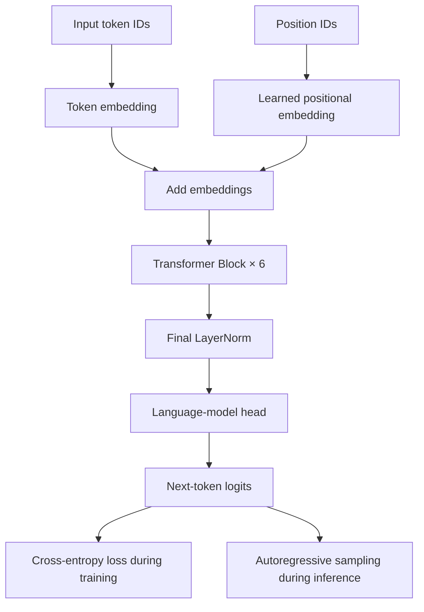
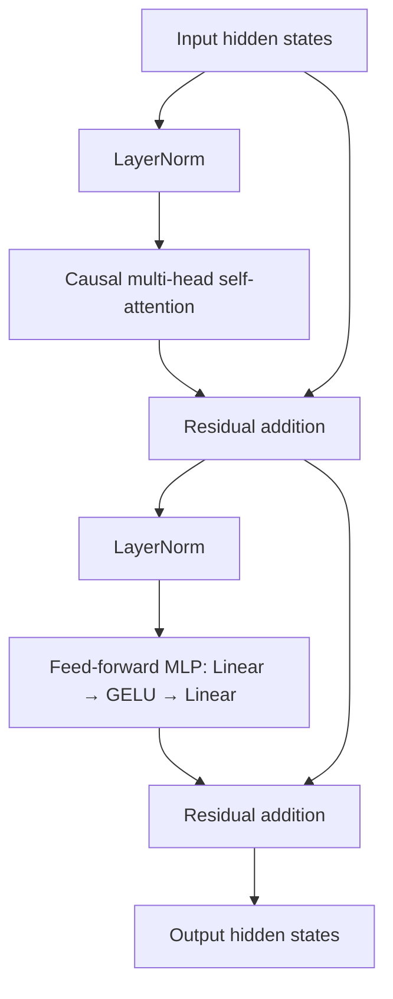

# GPT-Style Transformer from Scratch

A compact, decoder-only GPT-style language model implemented in PyTorch. This project covers the core training pipeline: WikiText-103 data preparation, GPT-2 BPE tokenization, causal self-attention, next-token prediction, checkpointed training, text generation, and validation perplexity.

The goal is to understand and implement the mechanics behind autoregressive language models—not to reproduce a production-scale GPT model or compete with pretrained foundation models.

## Project overview

| Property | Implementation |
|---|---|
| Architecture | Decoder-only GPT |
| Framework | PyTorch |
| Tokenizer | GPT-2 BPE through `tiktoken` |
| Dataset | WikiText-103 raw |
| Vocabulary | 50,257 tokens |
| Transformer layers | 6 |
| Attention heads | 6 |
| Embedding dimension | 384 |
| Feed-forward dimension | 1,536 |
| Context length | 256 tokens |
| Approximate parameters | 30 million |
| Optimizer | AdamW |
| Training steps | 500 (configured default) |
| Checkpointing | Every 100 steps and at final step |
| Device | CUDA when available; otherwise CPU |

## Architecture

The model follows a pre-layer-normalization GPT-style decoder. Token embeddings and learned positional embeddings are added before passing through six transformer blocks.

Each block applies causal multi-head self-attention and a feed-forward network, with residual connections around both sublayers. A final LayerNorm and a weight-tied language-model head produce next-token logits.



### Transformer block



**Attention implementation detail:** attention is provided by PyTorch's `torch.nn.MultiheadAttention`, with an explicit additive causal mask. The attention operation is not manually implemented from matrix multiplication primitives. This is an intentional implementation choice documented in `plan.md`.

The model ties the token embedding matrix to the output projection weights, reducing redundant parameters.

## Repository structure

```text
transformer-from-scratch/
├── data/
│   ├── download.py       # Downloads WikiText-103 raw splits
│   └── prepare.py        # GPT-2 tokenization and binary .bin files
├── model.py              # GPT config, transformer block, MLP, and GPT model
├── train.py              # Data loader, AdamW training, checkpoint save/resume
├── eval.py               # Validation loss and perplexity
├── sample.py             # Autoregressive text generation
├── requirements.txt      # Python dependencies
├── plan.md               # Design decisions and implementation plan
└── README.md
```

## Data pipeline

The data pipeline has two stages:

1. `data/download.py` loads the `Salesforce/wikitext` dataset configuration `wikitext-103-raw-v1` through Hugging Face Datasets. It writes train, validation, and test text files.
2. `data/prepare.py` tokenizes those files with the GPT-2 encoding from `tiktoken`. It writes flat binary token files using unsigned 16-bit integers.

The training and evaluation scripts read the prepared files with NumPy memory mapping. This avoids loading the entire token stream into memory.

Expected generated files:

```text
data/
├── wikitext-103-raw/
│   ├── train.raw
│   ├── validation.raw
│   └── test.raw
└── bin/
    ├── train.bin
    ├── val.bin
    ├── test.bin
    └── meta.txt
```

Generated dataset files and model checkpoints are runtime artifacts; they are not required to be committed to the repository.

## Setup

Python 3.10 or newer is recommended.

### 1. Clone the repository

```bash
git clone https://github.com/bhaskaranjappa/transformer-from-scratch.git
cd transformer-from-scratch
```

### 2. Create and activate a virtual environment

**Windows PowerShell**

```powershell
python -m venv .venv
.\.venv\Scripts\Activate.ps1
```

**Linux / macOS**

```bash
python -m venv .venv
source .venv/bin/activate
```

### 3. Install dependencies

```bash
python -m pip install --upgrade pip
pip install -r requirements.txt
```

For GPU training, install a PyTorch build compatible with your CUDA environment. See the [official PyTorch installation selector](https://pytorch.org/get-started/locally/) for the correct command.

## Run the project

Run commands from the repository root.

### 1. Download WikiText-103

```bash
python data/download.py
```

### 2. Tokenize and prepare binary splits

```bash
python data/prepare.py
```

### 3. Train the model

```bash
python train.py
```

The script automatically selects CUDA when available and otherwise uses CPU. It trains for 500 configured steps, printing the loss at each step. Checkpoints are written to `checkpoint.pt` every 100 steps.

If a checkpoint exists, training restores the model, optimizer, step, and data-loader position before continuing.

### 4. Evaluate

```bash
python eval.py
```

Evaluation reports mean validation cross-entropy loss and perplexity:

```text
perplexity = exp(mean_validation_loss)
```

### 5. Generate text

```bash
python sample.py
```

The current sampling script uses the prompt `The Transformer architecture`, generates up to 64 new tokens, and applies temperature and top-k sampling. It loads `checkpoint.pt` when available.

If no checkpoint exists, it deliberately runs an untrained model; generated text will not be meaningful.

## Training configuration

The main configuration is defined in `model.py` through the `GPTConfig` dataclass. Training hyperparameters are currently constants in `train.py`.

| Hyperparameter | Value |
|---|---:|
| Batch size | 12 |
| Block size | 256 |
| Learning rate | 0.0006 |
| Weight decay | 0.1 |
| AdamW betas | (0.9, 0.95) |
| Total steps | 500 |
| Checkpoint interval | 100 steps |

The training loop uses next-token targets: each input sequence is shifted by one token to form its target sequence.

## Results

The previous project README recorded the following validation result:

| Metric | Reported value |
|---|---:|
| Validation loss | 5.29 |
| Validation perplexity | ~198 |

These are reported project results, not independently reproduced by this README update. Results depend on the exact dataset files, checkpoint, and training run. The repository does not currently include a committed checkpoint, training log, or loss-curve artifact for independent verification.

This is an educational implementation and a training-pipeline exercise. The reported metric should not be compared directly with modern pretrained language models without matching dataset preprocessing and evaluation protocols.

## Engineering decisions

- **Decoder-only architecture:** trains autoregressively to predict the next token.
- **GPT-2 BPE tokenizer:** reuses a known 50,257-token vocabulary rather than training a tokenizer.
- **Causal attention mask:** prevents each position from attending to future tokens.
- **Pre-LayerNorm blocks:** normalize hidden states before attention and the MLP.
- **Weight tying:** shares token embedding and language-model output weights.
- **Binary token storage:** uses `uint16` files and memory mapping for efficient sequential batch reads.
- **Checkpoint resume:** saves model and optimizer states, training step, loss, and data-loader position.

## Current limitations

This repository is a compact learning implementation. It does not yet include several features expected in a robust large-scale training system:

- Attention uses PyTorch's built-in `MultiheadAttention`; attention projections and scaled dot-product attention are not implemented manually.
- No learning-rate scheduler, warmup, gradient clipping, dropout, or mixed-precision training is configured.
- Checkpoints do not currently preserve random-number-generator states.
- The data loader reads one flat token stream and wraps to the beginning; it does not implement shuffled document-level sampling.
- Evaluation computes average batch loss and perplexity, but does not report benchmark comparisons or confidence intervals.
- There is no automated test suite or committed reproducible training log.

These limitations are intentionally stated so the implementation's scope remains clear.

## Possible next improvements

1. Add unit tests for causal masking, tensor shapes, loss computation, and checkpoint restoration.
2. Add training and validation loss logging with reproducible plots.
3. Implement learning-rate warmup and cosine decay, gradient clipping, and mixed precision.
4. Preserve RNG states and strengthen checkpoint-resume reproducibility.
5. Add manual scaled dot-product attention as a separate educational implementation and compare it against PyTorch's module.
6. Improve batching and evaluation with document-aware boundaries and reproducible benchmark settings.

## Learning objectives

This project demonstrates practical understanding of:

- Decoder-only Transformer architecture
- Causal self-attention and masking
- Token and positional embeddings
- Residual connections and LayerNorm
- Feed-forward networks and GELU
- Autoregressive next-token training
- BPE tokenization and binary dataset preparation
- AdamW optimization and checkpoint-based training
- Text generation with temperature and top-k sampling
- Validation loss and perplexity

## License

No explicit license file is currently present. Check the repository's licensing status before reusing or redistributing the code.
